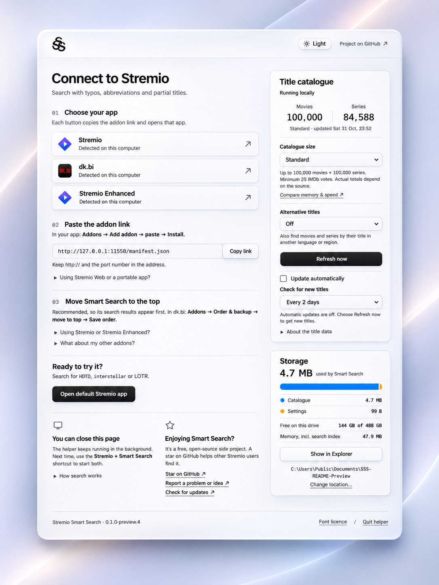
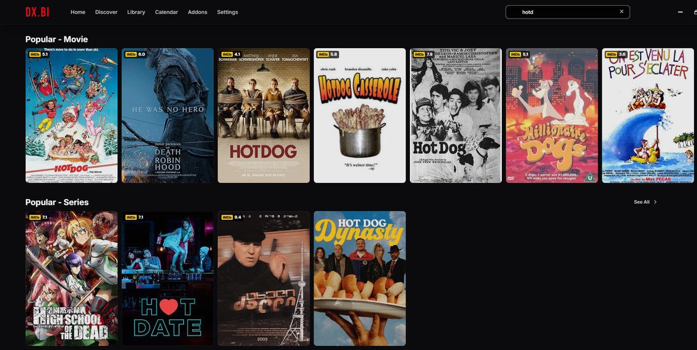
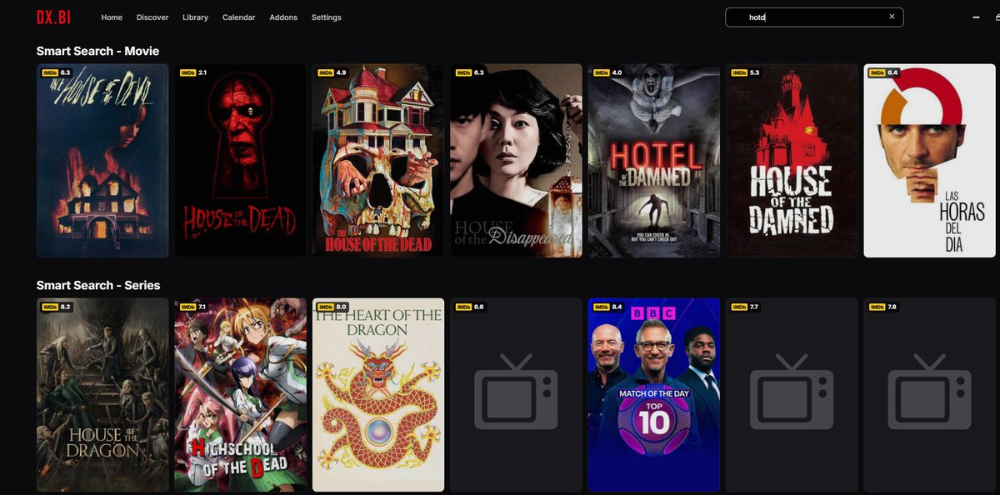
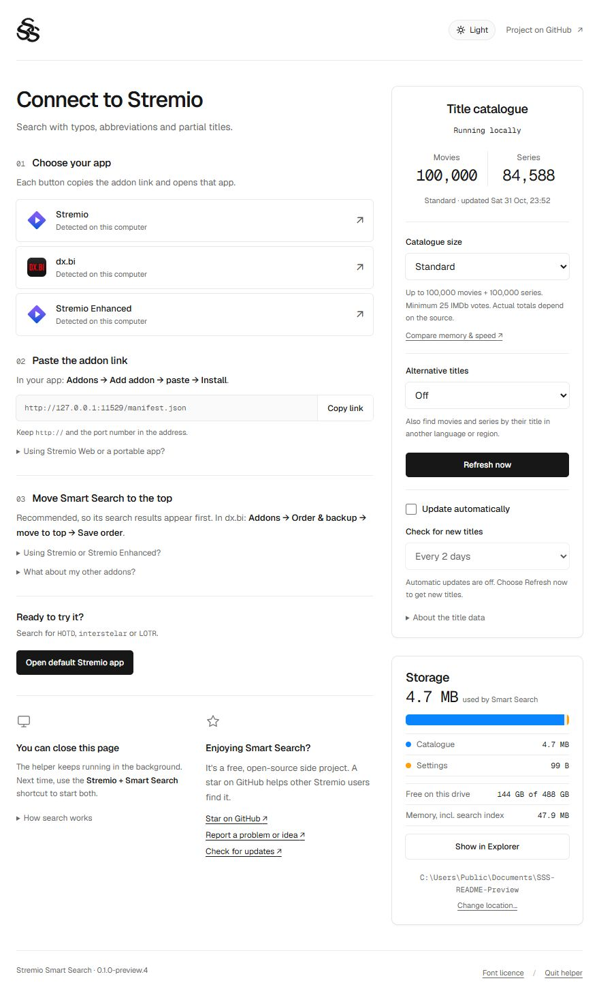
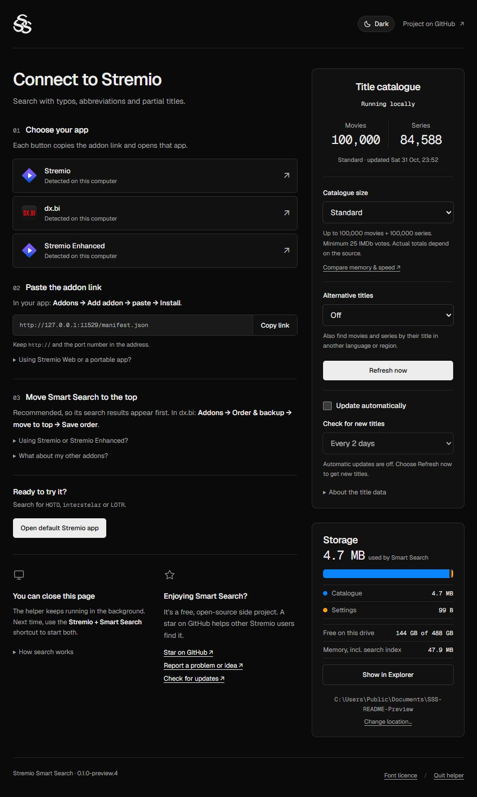

<picture>
  <source media="(prefers-color-scheme: dark)" srcset="docs/images/logo-dark.png">
  
</picture>

# Stremio Smart Search

**Find what you meant to type.** A local search addon for Stremio that understands typos, joined words and abbreviations.

[Download](https://github.com/EskimoDev/stremio-smart-search/releases) · [Install guide](docs/INSTALLATION.md) · [Changelog](CHANGELOG.md)

<picture>
  <source media="(prefers-color-scheme: dark)" srcset="docs/images/dashboard-showcase-dark.jpg">
  <source media="(prefers-color-scheme: light)" srcset="docs/images/dashboard-showcase-light.jpg">
  
</picture>

Stylised dashboard artwork; appearance, addresses and figures are illustrative. Use the addon link from your own settings page. <a href="#dashboard">Unedited screenshots</a>.

<b>Before:</b> searching <code>hotd</code> in dx.bi without Smart Search

<b>After:</b> the same search with Smart Search (Expanded catalogue)

## Installation

**Latest public preview: [0.1.0-preview.6](https://github.com/EskimoDev/stremio-smart-search/releases/tag/v0.1.0-preview.6).** It finds titles typed with several misspelled words or misplaced spaces, such as `gma e of thr`, answers searches 40 to 50% faster, starts about 40% faster, and keeps the private control key out of the settings page. For instructions matching an older download, use its tag-pinned guide: [preview.5](https://github.com/EskimoDev/stremio-smart-search/blob/v0.1.0-preview.5/README.md#installation) or [preview.4](https://github.com/EskimoDev/stremio-smart-search/blob/v0.1.0-preview.4/README.md#installation).

Choose the package for your computer:

| Your computer | Package | Testing |
|---|---|---|
| Windows, Intel/AMD | **Windows-x64-Setup.exe** or portable ZIP | Stremio, dx.bi and Enhanced tested |
| Windows on ARM | Windows-ARM64-Setup.exe or portable ZIP | Builds; device testing needed |
| Mac, M-series chip | macOS-AppleSilicon.dmg or app ZIP | Automated checks; desktop testing needed |
| Mac, Intel | macOS-Intel.dmg or app ZIP | Automated checks; desktop testing needed |
| Linux, Intel/AMD | Linux-x64.deb or portable .tar.gz | Ubuntu 24.04 tested |
| Linux on ARM | Linux-ARM64.deb or portable .tar.gz | Builds; device testing needed |

Package names also include the version number. Preview builds are not developer-signed or notarized; see the [installation guide](docs/INSTALLATION.md) for download checks and first-open prompts. [Full testing status →](docs/PLATFORM-TESTING.md)

SSS runs as a small helper on your computer. It needs to be running for its search results to appear. There is no native TV or phone helper yet; see [other devices](docs/OTHER-DEVICES.md).

1. **Install and open Smart Search.** Its settings page opens in your browser.
2. **Prepare the catalogue.** Leave **Catalogue size** on Standard, or choose another size, then select **Prepare catalogue**. The first download is a few hundred MB; allow several minutes.
3. **Add it to Stremio.** Choose your app: **Stremio**, **dx.bi** or **Stremio Enhanced**. This copies the addon link and opens the app. In that app, go to **Addons → Add addon**, paste the link and choose **Install**. If your app isn't detected, copy the link manually.
4. **Search normally.** Try `HOTD` and look for the Smart Search movie and series rows.

> [!TIP]
> Move Smart Search to the top of your addon order to find its results first. In dx.bi: **Addons → Order & backup → move Smart Search to the top → Save order**. For other clients, see [the ordering guide](docs/INSTALLATION.md#put-smart-search-first).

Next time, use **Stremio + Smart Search** to start both together. You can close the settings page; the helper keeps running. Use **Smart Search Settings** or the addon's **Configure** button to reopen it.

[Windows, macOS, Linux and portable instructions →](docs/INSTALLATION.md)

## Dashboard

Choose your app, catalogue size and update schedule in one place, with light and dark themes.

View unedited dashboard screenshots

  
  

Preview.4 in light and dark mode; click either image to enlarge. Shown with a prepared Standard catalogue and automatic updates off. Totals and storage use vary.

## Try a search

| You type | Title to look for |
|---|---|
| `hotd` | *House of the Dragon* |
| `strangerthings` | *Stranger Things* |
| `game of thornes` | *Game of Thrones* |
| `pulp fikshun` | *Pulp Fiction* |
| `star war` | Star Wars films |
| `strngr thngs` | *Stranger Things* |
| `dune 1984` | *Dune* (1984) |
| `les miserables` | *Les Misérables* |
| `la rene des neige` | *Frozen*, with French alternative titles enabled |

For translated or regional names, choose a language under **Alternative titles** in settings, then rebuild. This adds another data download. [Alternative-title setup →](docs/CATALOGUE.md#alternative-titles-optional)

A [38-query demonstration against Stremio’s default search](docs/SEARCH-QUALITY.md#compared-with-stremios-default-search-2026-11-02) found the expected title first on 36 queries with SSS and 25 with Cinemeta. It was run on the search code released in preview.6, includes queries used during development, and is not a blind accuracy test or a timing comparison.

Matching has limits: an exact title can rank above the similar title you meant. The sound-alike matcher finds `incepshun` and `back to the fucher`, but still misses `rattatooey`. See [tested search quality and known gaps](docs/SEARCH-QUALITY.md).

## Choose a catalogue

Standard is the default. Choose Compact to use less memory, or Expanded to include more titles with fewer IMDb votes. You can change size in settings; the current catalogue keeps working during a rebuild.

| Size | Titles in the measured snapshot | Memory after startup, Windows PC (preview.3) | Memory after startup, Linux cloud VM (preview.4) |
|---|---:|---:|---:|
| Compact | 50,000 | 23 MiB | 22 MiB |
| **Standard** | 184,606 | 53 MiB | 53 MiB |
| Expanded | 390,470 | 97 MiB | 97 MiB |

Both columns use IMDb data from 2026-11-01 with alternative titles off. The Windows PC is a Ryzen 5 5600X with 32 GiB RAM; the Linux VM has 4 vCPUs (Intel Xeon, 2.80 GHz) and 16 GiB. Windows reports working set and Linux reports RSS, which are different counters. On preview.4 the Windows PC measured 103 MiB for Expanded with `sss-bench`. Counts and memory vary. Each size keeps up to 25,000, 100,000 or 250,000 **each** of movies and series, subject to its vote threshold.

Matching runs locally. On preview.6 with the Windows PC, 95% of Expanded search requests, with French alternative titles on, finished within **0.57 ms** across 347 benchmark queries, including the local HTTP request and response, and the helper was ready 1.4 s after starting. This measures SSS, not the time for Stremio to load artwork or other addons' results. [Measurements and method →](docs/PERFORMANCE.md)

[Title selection, updates and storage →](docs/CATALOGUE.md)

## Privacy and online access

- SSS needs no account, Stremio password, API key or AI subscription.
- Matching happens on your computer. SSS does not send your searches to a search service; Stremio still queries your other installed search addons as usual.
- IMDb is contacted when you prepare or refresh the catalogue, and by automatic updates. Posters come from MetaHub; your other addons provide metadata and playback.
- **Automatic-update bandwidth:** new installations default to every 2 days while the helper runs. Each changed-data update downloads about **240 MB**, plus about **520 MB weekly** with alternative titles: roughly **3.6 GB/month**, or **5.8 GB/month** with alternatives. Existing catalogues remain manual until enabled. Turn **Update automatically** off for manual-only downloads. See [controls, metered connections and estimates](docs/CATALOGUE.md#automatic-updates).
- No telemetry. Settings are accessible from the host computer only.

The software is MIT licensed. IMDb data has [separate personal, non-commercial terms](DATA.md) and is downloaded by each user; it is not bundled in the app.

## Common questions

Do I need to keep the browser page open?

No. Close it after setup and keep using Stremio. The helper continues running until you choose **Quit helper**, stop its process or shut down your computer. The combined launcher starts it again next time. Windows setup also offers an optional start-at-sign-in component.

Can I use a TV, phone or Stremio Web?

Stremio Web on the same computer has an install option in settings. A localhost addon link does not run the helper on your TV or phone when your addons sync. Advanced home-server options still need client testing. See [other devices](docs/OTHER-DEVICES.md).

How do I move the catalogue or remove Smart Search?

Use **Change location…** in the settings page's **Storage** card to move the catalogue. To remove the app, follow [uninstall instructions](docs/INSTALLATION.md#uninstalling). Uninstalling keeps your downloaded data and does not remove the addon entry from Stremio.

## Help and contributions

[Report a problem](https://github.com/EskimoDev/stremio-smart-search/issues/new). For a wrong result, include your search, the expected movie or series, catalogue size and any alternative-title language or region. Please leave out account tokens and debrid credentials.

For code changes, start with [Contributing](CONTRIBUTING.md) and [Architecture](docs/ARCHITECTURE.md). The [documentation index](docs/README.md) lists setup guides, benchmarks and search-quality results.

## Licence and credits

[MIT](LICENSE). Independent community project; not an official Stremio product. SSS does not host or distribute video.

The setup page follows [LongCipher Design by Akagi201](https://designmd.ai/Akagi201/longcipher-design) (CC0), with Geist fonts under the SIL Open Font License. See [third-party notices](THIRD-PARTY-NOTICES.txt).

Thanks to [dx.bi](https://github.com/notdxbi/dxbi-stremio), whose README inspired this layout.
